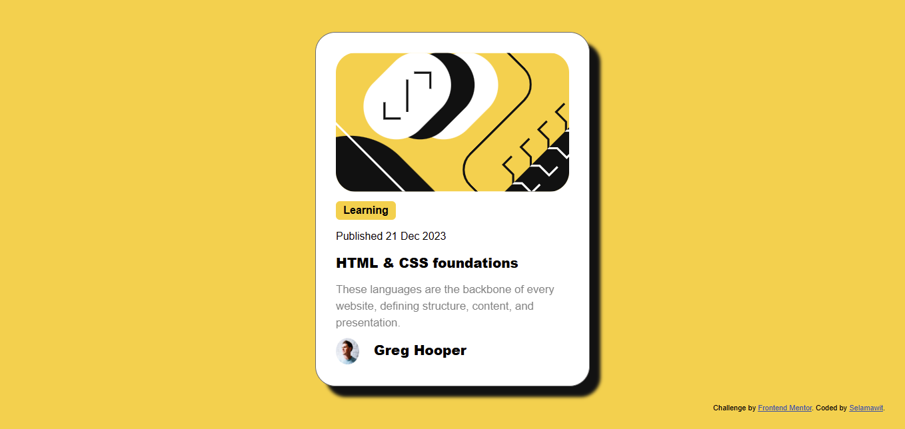
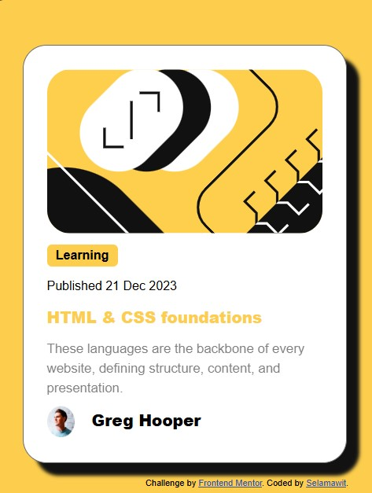

# Frontend Mentor - Blog preview card solution

This is a solution to the [Blog preview card challenge on Frontend Mentor](https://www.frontendmentor.io/challenges/blog-preview-card-ckPaj01IcS). Frontend Mentor challenges help you improve your coding skills by building realistic projects. 

## Table of contents

- [Overview](#overview)
  - [The challenge](#the-challenge)
  - [Screenshot](#screenshot)
  - [Links](#links)
- [My process](#my-process)
  - [Built with](#built-with)
  - [What I learned](#what-i-learned)
  - [Continued development](#continued-development)
  - [Useful resources](#useful-resources)
  - [AI Collaboration](#ai-collaboration)
- [Author](#author)
- [Acknowledgments](#acknowledgments)


## Overview

### The challenge

Users should be able to:

- See hover and focus states for all interactive elements on the page

### Screenshot





### Links

- Solution URL: [repository link](https://github.com/ane1897-dev/blog-card-design-using-html-and-css)
- Live Site URL: [Live site URL ](https://blog-card-design-using-css-and-html.netlify.app/)

## My process

### Built with

- Semantic HTML5 markup
- CSS custom properties
- Flexbox
- Mobile-first workflow


### What I learned

What i found interesting is without using media queries we can adjust the font-sizes of the text across different screens ranging from mobile to desktop. Because i done this project in mobile-first design, the fonts were higher then when expanding the screen size, they become smaller.

```css
p1{
    font-size: clamp(1.05rem, 1.15rem - 0.5vw, 1.0rem);
    font-weight: 500;
    opacity:0.5;
    text-align: left;
    line-height: 1.5;
}
```


### Continued development

Even though i used the css clamp, i want to understand more like the 3 parameters it accepts and more on how to hover in links and also box-shadow which accepts 4 number values with additional color.

## Author

- Frontend Mentor - [@ane1897-dev](https://www.frontendmentor.io/profile/ane1897-dev)


## Acknowledgments

Frontend Mentor has vast challenges for beginners and step by step help developers to reach their higher level by making the site Available of cost and giving feedback on the worked challenges(solutions). These makes it similar to how real world jobs are conducted, giving us an early insight, which is very helpful. 
